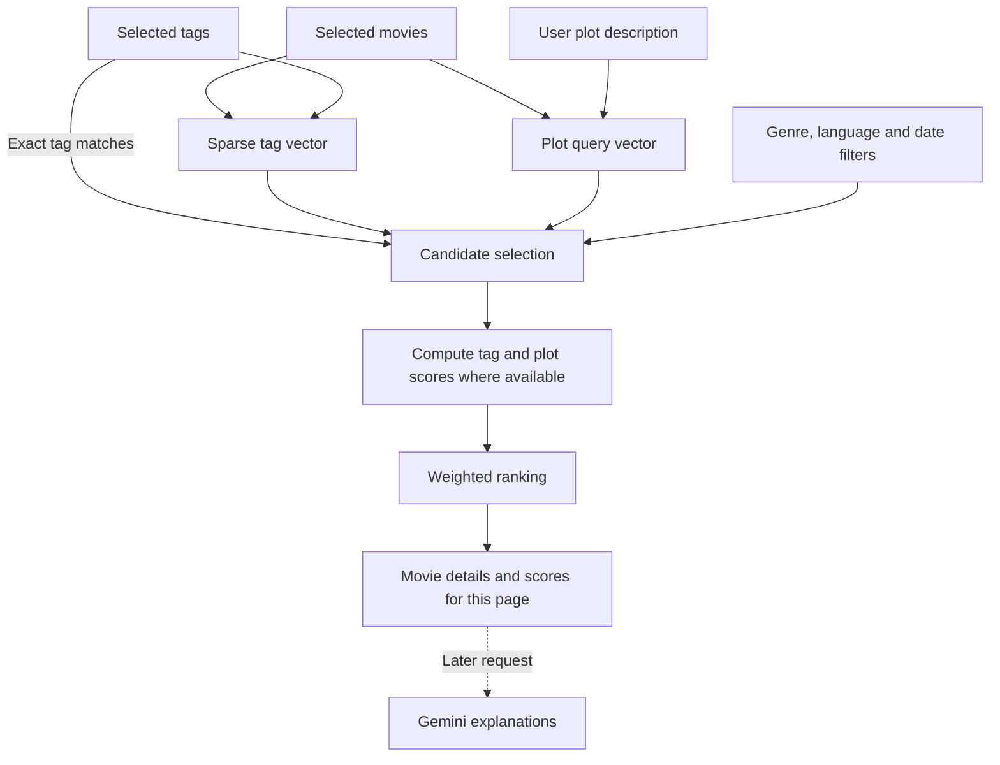
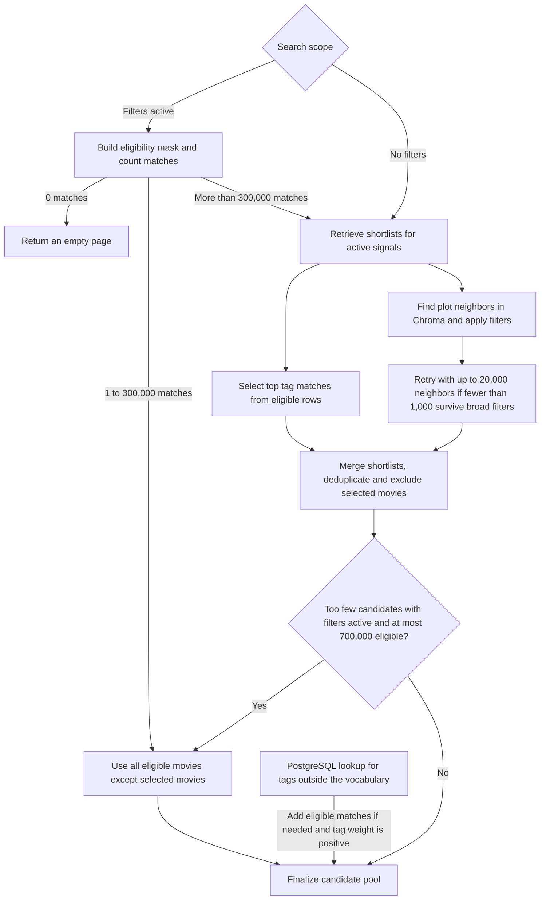
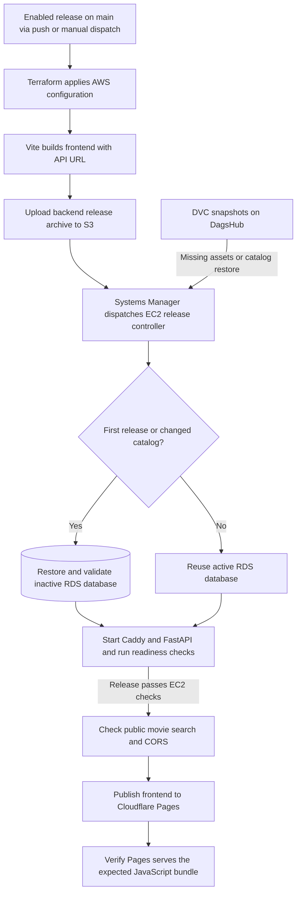

# DualLens Movie Recommendation System

[DualLens](https://duallens-movies.app/) helps you find films by what happens in the story and by details such as cast, director, genre, and keywords. Start with a movie you like, choose a tag, or describe a plot in your own words. For example, if you like *Interstellar*, you can give more weight to plot to look for similar stories, or more weight to tags to favor films that share its cast, creators, or genres.

## How recommendations work



<details>
<summary>Candidate selection flowchart</summary>



</details>

### Turning a request into two vectors

**Tags capture explicit similarities.** Each row of the sparse tag matrix represents a movie. Its nonzero entries describe features such as cast members, genres, directors, and keywords. The query builder normalizes the selected movies’ rows to unit length before averaging them, so one film with many tags does not dominate just because its record is longer. It transforms user-selected tags with the same fitted vectorizers used to build the catalog matrix, then combines those features with the movie average. A selected name missing from the fitted vocabulary can still contribute through an exact lookup in the corresponding PostgreSQL field. [Tag encoding](backend/app/services/soup.py) · [Query construction](backend/app/services/query_builder.py)

**Plots capture similarity in meaning.** The backend retrieves the selected films’ stored synopsis embeddings from Chroma and averages the usable vectors. It encodes free-text input locally with `all-MiniLM-L6-v2` into a normalized 384-dimensional vector. When both sources exist, it gives half the weight to the selected films’ combined plot and half to the user’s description, then normalizes again. This blend happens *within* the plot signal. The tag-versus-plot slider applies later, when ranking films. Missing and flagged boilerplate synopses are excluded from the plot average. [Text encoder](backend/app/stores/text_embedder.py) · [Query construction](backend/app/services/query_builder.py)

### Deciding which movies to score

Filters define eligibility. For example, selecting *science fiction or drama*, English, and a release date after 2000 requires a film to satisfy the language and date constraints and match at least one selected genre. The backend computes a Boolean mask over an in-memory metadata index, using integer language codes, genre bit masks, and release dates. It excludes the input movies from the results. [Metadata index](backend/app/stores/meta_index.py)

| Query scope | Default retrieval behavior |
| --- | --- |
| Filters leave 300,000 movies or fewer | Score every eligible movie. A movie that matches both signals moderately well can still reach the top even if it would miss either signal’s individual shortlist. |
| No filters, or a broader eligible set | For a two-signal query, run sparse tag matrix multiplication and Chroma approximate nearest-neighbor plot search concurrently. The default retrieval depths are 10,000 tag matches and 5,000 plot neighbors. With filters active, select tag matches from eligible rows and apply the eligibility mask to the plot neighbors after retrieval. Merge the two lists, deduplicate, and exclude selected movies. |
| Too few candidates survive broad filters | If fewer than 1,000 plot neighbors survive, retry with up to 20,000 neighbors. After the retry, if an active signal still yields fewer than 1,000 survivors or the merged pool falls below 2,000, use the entire filtered set when it contains at most 700,000 movies. |

With positive tag weight, exact PostgreSQL tag matches can supplement the shortlist or supply the entire candidate pool when no query vector is available. A full filtered scan already includes all eligible exact matches.

The broader search trades some recall for less scoring work. A film outside both shortlists can miss the final ranking even if its combined score would have been competitive. These thresholds are implementation defaults. [Candidate selection](backend/app/services/candidates.py) · [Ranking settings](backend/app/config.py)

### Computing the final score

For each candidate, the backend computes tag cosine similarity using the original sparse features and reuses tag scores already computed during retrieval where available. When selected tags fall outside the fitted vocabulary, it blends the cosine score with the fraction of those tags matched in PostgreSQL. For plots it computes the dot product of normalized vectors, which equals cosine similarity. Chroma helps find candidates, while final plot scoring reads precomputed vectors from a memory-mapped file in row order, in batches of up to 8,192. This bounds the size of the temporary embedding array. [Candidate scoring](backend/app/services/scoring.py)

```text
final score = tag weight × tag similarity + (1 − tag weight) × plot similarity
```

For example, a film with tag similarity **0.80** and plot similarity **0.50** scores **0.62** at a tag weight of **0.40**. If its plot is unavailable, its score at the same setting is **0.32**. The API marks the plot score as missing, clips usable component scores to the 0–1 range, and keeps only positive combined scores. By default it returns up to 100 ranked films, breaking ties by plot similarity and then ascending movie ID. [Score fusion](backend/app/services/fusion.py)

### Serving a page and explaining a match

The API caches the ranked IDs and scores under a request ID derived from the normalized inputs. Reordering selected tags or changing the page size can reuse the same ranking. PostgreSQL supplies the movie details for the requested page. The process-local cache holds up to 200 rankings with a sliding 15-minute expiry, so browsing subsequent pages usually avoids another vector search. [Pagination cache](backend/app/services/paging.py) · [Recommendation API](backend/app/api/recommend.py)

A separate request asks Gemini to explain the films on that page. Its payload includes selected movies, overlapping tags, synopsis excerpts, the component scores, and the user’s plot description when supplied. Generated explanations are cached per movie within the ranking. An explanation failure leaves the scores and ordering available. [Explanation service](backend/app/services/explain.py)


## Technology stack

| Layer | Technology and role |
| --- | --- |
| Web application | React manages search, filters, movie details, and paginated recommendations. Vite builds the static site served by Cloudflare Pages. |
| API and catalog | Python, FastAPI, and Uvicorn serve the API. PostgreSQL stores movie details and supports title and tag lookups. Production uses Amazon RDS. |
| Recommendation engine | NumPy, SciPy, and scikit-learn handle vector operations and sparse tag features. Sentence Transformers encodes plot text, and embedded ChromaDB stores plot embeddings and retrieves similar plots. |
| Data and releases | DVC versions the catalog snapshot, model artifacts, and Chroma index. GitHub Actions coordinates releases, Terraform manages AWS infrastructure, and Docker Compose runs the API and Caddy reverse proxy on EC2. |

## Production deployment pipeline




1. **Prepare infrastructure and frontend.** With production releases enabled, GitHub Actions responds to changes on `main` that affect the app, data pointers, or infrastructure. Terraform applies the AWS configuration, and Vite builds the frontend with the production API URL. The workflow supports either a CloudFront endpoint or a custom API hostname.
2. **Assemble the backend release.** Actions uploads a commit-tagged source archive to Amazon S3. AWS Systems Manager instructs EC2 to retrieve it. The release controller assembles the matching DVC artifacts and Chroma index. On the first release or when the catalog snapshot changes, it restores the snapshot into an inactive RDS database before switching the API to it.
3. **Promote the API, then publish the site.** EC2 starts the containerized release behind Caddy. If its startup checks fail, the controller attempts to restore the previous release. Once the public API returns movie search results and permits requests from the frontend origin, Actions publishes the site to Cloudflare Pages and confirms it serves the expected JavaScript bundle. [Release workflow](.github/workflows/deploy.yml) · [EC2 release controller](deploy/aws/sync.py)

**Release consistency.** The controller tracks the backend Git revision and the DVC hashes for the catalog, model artifacts, and Chroma index. EC2 reuses artifact directories keyed by hash and mounts the model artifacts read-only. Chroma gets a writable copy for its SQLite metadata. An application-only release can therefore reuse the active database and index. A catalog change is restored and validated in the other database slot while the active catalog remains available. [Production containers](compose.ec2.yml) · [Release state and asset management](deploy/aws/sync.py)

## Strengths and limitations

| Strength | Limitation |
| --- | --- |
| A first-time visitor can get recommendations from a single film or plot idea, without building a viewing history. | The system uses the preferences expressed in each query. It does not learn individual taste from ratings or other viewers’ behavior. |
| Separate plot and tag scores let you see why a movie ranked highly and adjust the balance. | Catalog coverage affects ranking. A film with a missing synopsis can be a strong tag match yet rank lower when plot carries more weight. |
| Precomputed features and a persistent vector index let the API reuse work across requests. | Catalog updates require compatible data and index snapshots. The embedded index and process-local result cache also constrain scaling beyond the current single-worker deployment. |
| Gemini adds a readable explanation after the ranked list is available. | Explanations depend on an external service and can arrive late or be unavailable even when the recommendations succeed. |

## License

The project code is licensed under the [MIT License](LICENSE).
